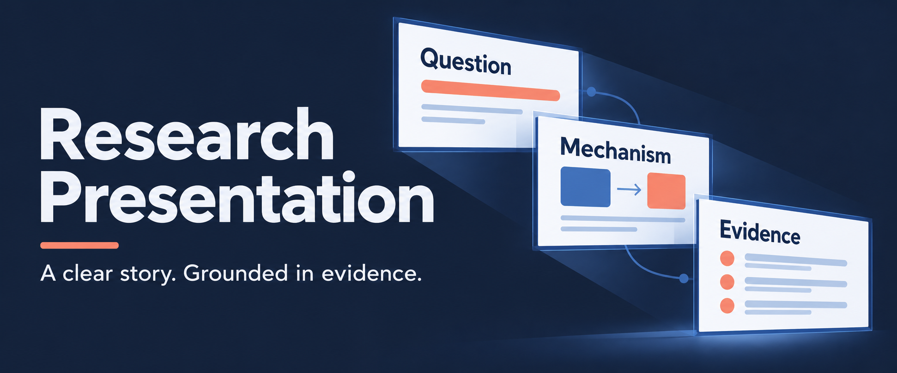
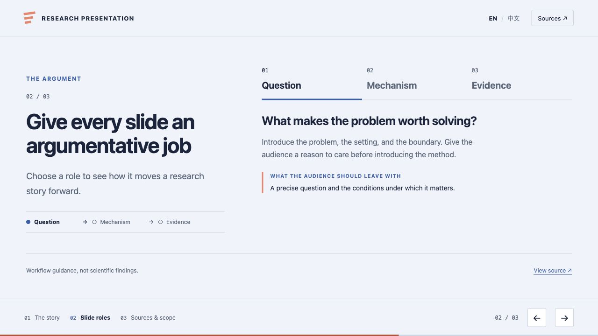

# Research Presentation

Turn a research project or paper PDF into a standalone HTML talk, with a clear argument and claims traced to their sources.

**[▶ Open interactive demo](https://delong-l.github.io/Research-Presentation-Skill/)** · [Install the skill](#get-started) · [User guide](docs/guide.md) · [简体中文](README.zh-CN.md)

<a href="#see-the-result"></a>

[](LICENSE)

## Start with your research

- **A project directory** → A group-meeting talk, research update, or defense-style presentation built from the available evidence.
- **A paper PDF** → A walkthrough of the question, method, evidence, and limitations, with references back to the paper.
- **An existing deck and its sources** → Revised claims, consistent terminology, and clearer slides while preserving working interactions.

Each slide has a job in the argument. Figures, numbers, and comparisons stay connected to their sources; uncertainty and limitations remain visible.

<a id="see-the-result"></a>
## See the working deck

[](https://delong-l.github.io/Research-Presentation-Skill/)

A three-slide example using the skill's own documentation as its source. Switch between argumentative roles, inspect the sources, and move through the slides with buttons or the keyboard. It presents no experimental findings.

**[▶ Open the English interactive demo](https://delong-l.github.io/Research-Presentation-Skill/)**

<details>
<summary><strong>Prefer to try it offline?</strong></summary>

[Download the repository ZIP](https://github.com/DELONG-L/Research-Presentation-Skill/archive/refs/heads/main.zip), extract it, and open `examples/demo/index.html` in a browser. The same example runs locally without a build step or external runtime assets.

</details>

<a id="get-started"></a>
## Install and try a task

For a **fresh installation** on macOS or Linux:

```bash
git clone https://github.com/DELONG-L/Research-Presentation-Skill.git
cd Research-Presentation-Skill
mkdir -p "${CODEX_HOME:-$HOME/.codex}/skills"
ln -s "$(pwd)/research-presentation" "${CODEX_HOME:-$HOME/.codex}/skills/research-presentation"
```

If the skill is already installed, preserve local changes before replacing it. Copy the `research-presentation/` folder if symbolic links are unavailable. Open a new Codex task, provide your source directory, and ask:

```text
Use $research-presentation to
turn this project into a
group-meeting HTML talk.
Build a reviewable draft from
the available evidence and
preserve claim boundaries.
```

<details>
<summary><strong>Working from a PDF or revising a deck?</strong></summary>

**Explain a paper**

```text
Use $research-presentation to
explain this PDF as a 15-minute
research talk. Trace claims and
figures to the paper, and keep
its limitations visible.
```

**Revise an existing talk**

```text
Use $research-presentation to
revise this deck against its
source records. Fix unsupported
claims and inconsistent terms;
preserve working navigation.
```

</details>

## What comes with the talk

- **An offline HTML deck** — `index.html` and local assets, with keyboard navigation, touch gestures, and printing.
- **A source record** — `presentation-manifest.yml` maps claims, figures, numbers, and citations to their evidence.
- **Narrative and terminology records** — `LANGUAGE-AUDIT.md` checks terms and claim strength; project mode also includes `NARRATIVE-CONTRACT.md`.

Project mode builds a reviewable draft by default. The Narrative Gate supports an explicit discussion-first request or a consequential unresolved choice; the narrative is frozen only after actual user confirmation.

The scaffold and validators use Python 3 with no third-party Python packages. See the [user guide](docs/guide.md) for commands, output structure, and checks.

[Skill instructions](research-presentation/SKILL.md) · [English example source](examples/demo/index.html) · [Chinese example source](examples/demo/zh/index.html) · [Visual assets and sources](docs/visuals.md) · [MIT licence](LICENSE)
