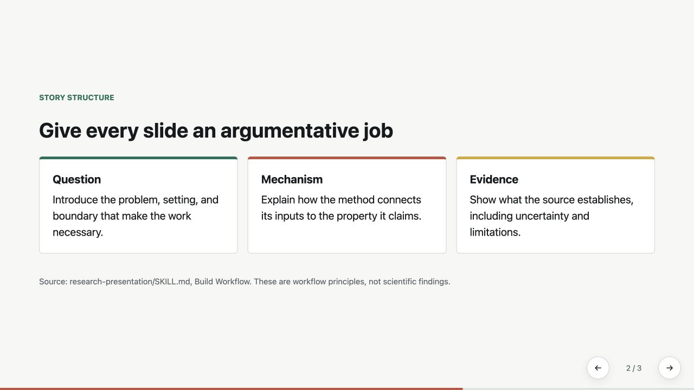

<div align="center">

<h1>Research Presentation</h1>
<p>Turn research projects and papers into evidence-grounded HTML talks.</p>
<p><a href="LICENSE"></a></p>
<p><a href="#get-started"><strong>Get started</strong></a> · <a href="docs/guide.md">User guide</a> · <a href="README.zh-CN.md">简体中文</a></p>

</div>

## See the result

[](examples/demo/index.html)

A working deck demonstrating layout, navigation, and provenance without invented experimental results. Download the repository and open `examples/demo/index.html` directly to try it.

## Choose your input

| Your source | Presentation |
|---|---|
| Research project directory | Group meeting, progress talk, defense, or claim-evidence briefing |
| One academic PDF | A faithful walkthrough of the question, mechanism, evidence, and limitations |
| Existing deck and sources | A revision that checks claims, terminology, citations, and visual clarity |

Project mode records a draft narrative and builds a reviewable deck by default. Use the Narrative Gate for an explicit discussion-first request or a consequential unresolved choice. Freeze a contract only after actual confirmation.

## Get started

For a fresh installation:

```bash
git clone https://github.com/DELONG-L/Research-Presentation-Skill.git
cd Research-Presentation-Skill
mkdir -p "${CODEX_HOME:-$HOME/.codex}/skills"
ln -s "$(pwd)/research-presentation" "${CODEX_HOME:-$HOME/.codex}/skills/research-presentation"
```

Preserve local changes if the skill is already installed. Copy the skill folder if symbolic links are unavailable. The [user guide](docs/guide.md) covers scaffolding, validation, and output files.

```text
Use $research-presentation to turn this project into a group-meeting talk.
Build a reviewable draft from the available evidence and preserve claim boundaries.
```

## What you receive

A standalone HTML deck, local assets, a source and claim manifest, and a terminology audit; project mode also includes a narrative contract. The deck needs no build step and supports keyboard navigation, touch gestures, and printing. Validation scripts require Python 3 with no third-party packages.

[Skill instructions](research-presentation/SKILL.md) · [Working example](examples/demo/) · [Detailed guide](docs/guide.md) · [MIT licence](LICENSE)
